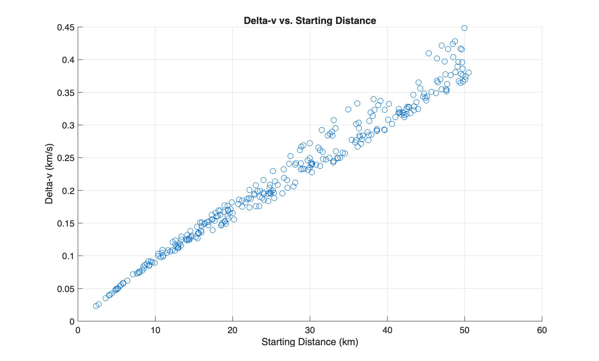
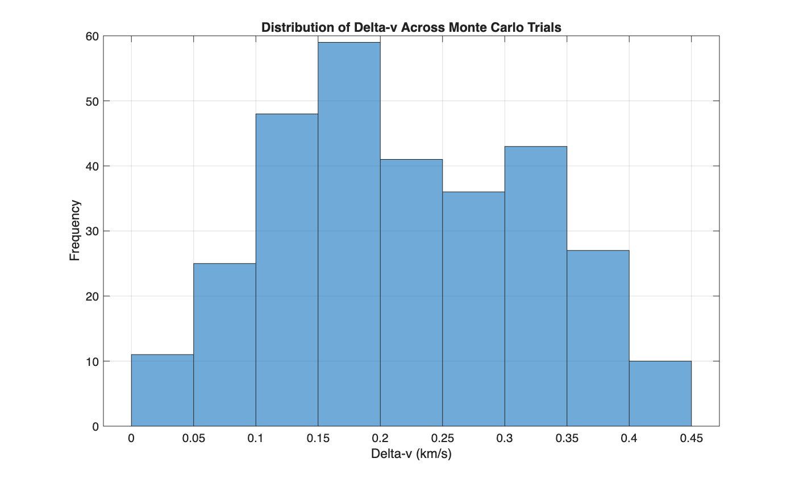
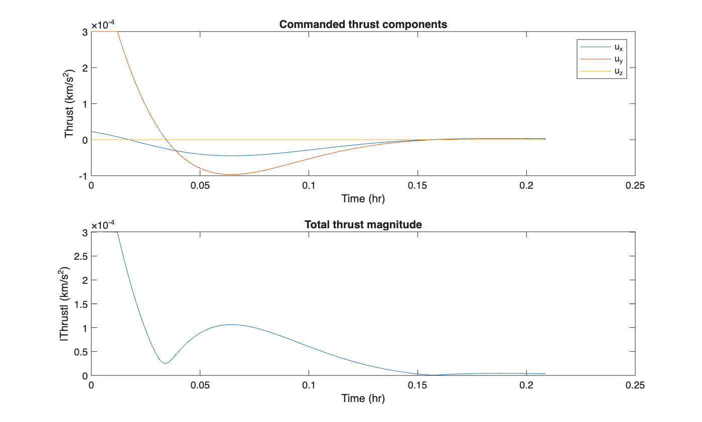

# cw-rendezvous

A MATLAB spacecraft rendezvous simulator using Clohessy-Wiltshire relative motion dynamics and a from-scratch LQR controller, validated against an analytical solution and stress-tested with a 300-trial Monte Carlo dispersion analysis.



## Key Results

- 100% capture rate across 300 randomized starting conditions (±15 km radial, ±50 km along-track)
- Delta-v cost ranges 22.9-448 m/s depending on starting distance, with saturated (physically realistic) thrust
- Numerical propagation matches the closed-form CW solution to 1.517 x 10^-4 km max error
- LQR gains computed by hand via Hamiltonian eigendecomposition, no Control System Toolbox

## Prerequisites

- MATLAB (developed on R2026a)
- No additional toolboxes required

## Installation

```bash
git clone https://github.com/pjheld/cw.git
cd cw
```

Open the folder in MATLAB and add it to your path.

## Usage

```matlab
main.m                    % single rendezvous example, with plots
monte_carlo_analysis()    % 300-trial dispersion analysis
```

## Background

Orbital rendezvous means maneuvering a chaser spacecraft to close in on and match orbits with a target using controlled thrust. The Clohessy-Wiltshire (CW) equations linearize the chaser's relative motion about the target's circular orbit, giving a state-space model a linear controller can act on directly.

This project simulates a chaser starting from a randomized offset relative to a target in a 400 km circular orbit, drives it to rendezvous with an LQR controller under saturated thrust, and characterizes performance across a wide range of starting conditions.

## Method

- **Dynamics:** Linearized CW state-space equations (`A`, `B` matrices)
- **Controller:** LQR gain matrix `K` via Hamiltonian eigendecomposition, solving the algebraic Riccati equation by hand (`lqr()`/`care()` require Control System Toolbox, unavailable here)
- **Cost weighting:** `Q = diag([1,1,1,1,1,1])`, `R = diag([1e8,1e8,1e8])`
- **Actuation:** Thrust saturated per-axis at `u_max = 3e-4 km/s^2`
- **Propagator:** `ode45`, `RelTol=1e-9`, `AbsTol=1e-12`, 5 orbital periods per trial

## Validation

### Numerical vs. Analytical CW Solution

| Metric | Value |
|---|---|
| Max position error | 1.517 x 10^-4 km |
| Mean position error | 6.019 x 10^-5 km |

### Jacobi Constant Conservation

| Metric | Value |
|---|---|
| Relative drift | 0.016% |

An earlier version of this check included a spurious angular-momentum term not actually conserved under CW dynamics, which produced artificially large drift. Correcting the formula brought drift down to a value consistent with integrator tolerance.

## Monte Carlo Dispersion Analysis

300 trials with randomized initial offsets: radial `x0` in [-15, 15] km, along-track `y0` in [-50, 50] km, all initial velocities and `z0` held at zero.

| Metric | Value |
|---|---|
| Capture rate | 100% |
| Delta-v, min / mean / max | 22.9 / 221.5 / 448.1 m/s |
| Final position error, mean / max | 3.05 x 10^-13 / 1.37 x 10^-12 km |

Every trial converged regardless of starting position, consistent with the closed-loop system's linear, symmetric stability. Delta-v scales with starting distance in a tight, near-deterministic relationship, since the only randomized input across trials is the initial condition; no sensor or process noise is currently modeled.



## Thrust Profile

Commanded thrust components and total magnitude for a single default trial, saturated at the hardware limit.



## Limitations

- No estimator: the controller acts on true state directly, no sensor noise or state estimation modeled (a Kalman filter is a planned addition)
- Linearized dynamics only, valid for circular target orbits and small relative separations
- Per-axis thrust saturation, so combined thrust magnitude can slightly exceed `u_max` when multiple axes saturate at once
- No orbital perturbations modeled (no J2, drag, third-body effects)

## License

MIT
