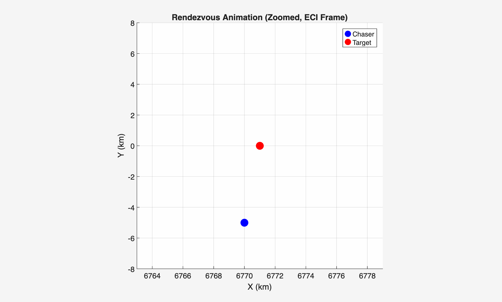

# cw-rendezvous

A MATLAB spacecraft rendezvous simulator using Clohessy-Wiltshire relative motion dynamics and a from-scratch LQR controller, verified against the analytical CW solution and stress-tested with a 300-trial Monte Carlo dispersion analysis.



## Key Results

- 100% capture rate across 300 randomized starting conditions (±15 km radial, ±50 km along-track) under per-axis thrust saturation
- Delta-v ranges 22.9–448 m/s, scaling with starting distance
- Numerical propagation matches the closed-form CW solution to 1.48 × 10⁻⁸ km max error
- LQR gain computed by hand via Hamiltonian eigendecomposition; matches MATLAB's `care()` to 7.5 × 10⁻¹⁷

## Prerequisites

- MATLAB (developed on R2026a)
- No additional toolboxes required to run the simulation

## Installation

```bash
git clone https://github.com/pjheld/cw-rendezvous.git
cd cw-rendezvous
```

Open the folder in MATLAB and add it to your path.

## Usage

```matlab
main                      % single rendezvous example, with animation
monte_carlo_analysis()    % 300-trial dispersion analysis

% Verification against the analytical CW solution
[x0, ~, n, ~] = orbital_params();
[A, ~] = cw_dynamics(n);
validate(x0, n, A);
```

## Background

Orbital rendezvous means maneuvering a chaser spacecraft to close in on and match orbits with a target using controlled thrust. The Clohessy-Wiltshire (CW) equations linearize the chaser's relative motion about the target's circular orbit, giving a state-space model a linear controller can act on directly.

This project simulates a chaser starting from an offset relative to a target in a 400 km circular orbit, drives it to rendezvous with an LQR controller under saturated thrust, and characterizes performance across a wide range of starting conditions.

## Method

- **Dynamics:** Linearized CW state-space equations (`A`, `B` matrices) in the LVLH frame
- **Controller:** LQR gain matrix `K` from the algebraic Riccati equation, solved by hand via Hamiltonian eigendecomposition
- **Cost weighting:** `Q = diag([1,1,1,1,1,1])`, `R = diag([1e8,1e8,1e8])`
- **Actuation:** Thrust saturated per-axis at `u_max = 3e-4 km/s²`
- **Propagator:** `ode45`, `RelTol=1e-9`, `AbsTol=1e-12`, 5 orbital periods per trial

## Verification

| Check | Result |
|---|---|
| Numerical vs. analytical CW solution (no thrust), max / mean position error | 1.48 × 10⁻⁸ / 5.78 × 10⁻⁹ km |
| Jacobi constant relative drift (no thrust) | 1.5 × 10⁻⁶ % |
| LQR gain vs. MATLAB `care()` (Control System Toolbox) | max difference 7.5 × 10⁻¹⁷ |

The first two checks confirm the dynamics and integrator; the third confirms the controller gain.

## Monte Carlo Dispersion Analysis

300 seeded trials with uniformly randomized initial offsets: radial `x0` in [-15, 15] km, along-track `y0` in [-50, 50] km, all initial velocities and `z0` held at zero. Capture is defined as ending within 10 m of the target.

| Metric | Value |
|---|---|
| Capture rate | 100% |
| Delta-v, min / mean / max | 22.9 / 221.5 / 448.1 m/s |
| Final position error, mean / max | 3.05 × 10⁻¹³ / 1.37 × 10⁻¹² km |

Every trial converged despite thrust saturation. Delta-v scales tightly with starting distance, since the initial offset is the only randomized input. The truth model is the same CW model the controller was designed on, so these results characterize saturation effects, not real-world model error.


## Thrust Profile

Commanded thrust components and total magnitude for a single default trial, saturated at the per-axis limit.


## Limitations

- Same CW model used for controller design and simulation truth; a nonlinear two-body truth model is a planned addition
- No estimator: the controller acts on true state directly (a Kalman filter is a planned addition)
- Continuous, throttleable thrust; real thrusters are typically on/off
- Thrust cap (0.3 m/s²) is generous relative to typical proximity-operations thrusters
- Capture defined by position only, with no closing-velocity requirement
- Per-axis saturation, so combined thrust magnitude can exceed `u_max` when multiple axes saturate at once
- Valid only for circular target orbits and small relative separations; no J2, drag, or third-body effects

## License

MIT